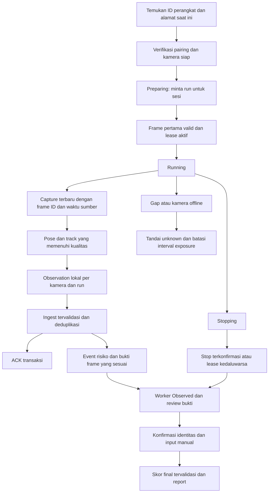

# Audit Deteksi dan Pencatatan ERGoSIGHT

Tanggal: 24 Oktober 2026, Asia/Singapore.
Status: audit dan rencana; perbaikan runtime belum diterapkan.
Baseline aplikasi: `c0e7d0a`. Baseline edge: `1640ede`.

## Ringkasan

ERGoSIGHT menangkap pose di Raspberry Pi, mengirim sampel deteksi ke backend laptop,
lalu menyimpan worker, kejadian, review, dan laporan. Audit mengasumsikan satu laptop
Windows dengan backend SQLite bawaan installer, satu kamera dahulu, 1-3 worker,
sesi 60 menit; pengujian dua kamera menjadi gate berikutnya.

Keempat keluhan memiliki dasar di implementasi. Masalah tidak terbatas pada UI:
identitas kamera, waktu frame, pemilihan bukti, dan status sesi belum mempunyai
pemeriksaan yang konsisten. Sistem belum layak dinyatakan siap bagi operator
non-IT sebelum temuan wajib di bawah ditutup.

Audit membaca alur edge, Electron, backend, model, migrasi, tes, serta jalur
review/analytics/report yang memakai hasilnya. Graphify dipakai untuk peta panggilan;
setiap temuan diverifikasi kembali terhadap source saat ini, karena graph edge lama
memiliki lokasi yang sudah tertinggal. Ekstraksi AST baru memindai 97 file aplikasi
dan 15 file edge, tanpa mengirim source atau kredensial ke layanan LLM eksternal.

## Bukti Pemeriksaan

### Perangkat yang benar-benar terhubung

- Saat audit, `10.55.0.1:8765` menjawab sebagai `CAM_02`, hostname `ergosight-cam02`.
- SSH mengonfirmasi edge commit `1640ede`, Hailo Apps commit `891ce70`.
- Konfigurasi edge: camera 12 FPS, JPEG inference 6 FPS, event 4 FPS, hand 3 FPS,
  batas reacquisition identitas 10 detik, ambang histogram 0.76.
- `/stream/status`: `running=false`, kamera tersedia, umur preview sekitar 60 ms.
- `/dev/video0` dan `/dev/video1` ada; `throttled=0x0`, disk root terpakai 6%.
- Tidak memulai sesi, menghentikan service, reboot, atau mengubah konfigurasi Pi.
  Kondisi idle ini belum membuktikan performa saat inferensi berjalan lama.

### Baseline otomatis

| Pemeriksaan | Hasil |
| --- | --- |
| Backend `python -m pytest -q` | 17 lulus |
| Edge `python -m pytest -q` | 13 lulus |
| Desktop `npm.cmd run build` | Lulus |
| Desktop `npm.cmd run lint` | Lulus |
| Probe kegagalan terisolasi | 11 kelompok masalah terkonfirmasi |

Probe menggunakan database SQLite dalam memori, pengguna fiktif, gambar sintetis,
dan mock HTTP. Database pengguna dan rekaman asli tidak disentuh.
Scratch lokal: `tmp/audit-20261024/probe_failures.py`, dikecualikan dari Git.

Hasil probe penting:

| Skenario | Perilaku aktual |
| --- | --- |
| Dua kamera mengirim `REID_0001` dalam satu sesi | Hanya satu `SessionWorker` |
| Kamera milik akun lain mengirim ke sesi completed | Tetap tersimpan |
| Payload yang sama dikirim dua kali | Dua baris deteksi |
| Akun B berlangganan sesi akun A | Menerima deteksi akun A |
| Edge tanpa autentikasi dan tanpa pairing yang dikenal | Tetap mendapat ACK |
| Kamera `online`, `last_seen_at` 30 hari lalu | API tetap mengembalikan `online` |
| Satu sampel risiko, orang hilang, stop pada detik 60 | Risiko tercatat 60.000 ms |
| Pose pertama insufficient, sampel berikutnya lebih baik | Sumber review tetap pose pertama |
| Review atas pose insufficient | HTTP 200, final REBA 1 |
| Seluruh edge gagal dihubungi saat start | Sesi menjadi `running` |
| Recapture gambar berbeda untuk event lama | File/bukti lama tertimpa, waktu tetap waktu event |
| Kamera unavailable, cache gambar berumur 120 detik | `read()` tetap mengembalikan gambar |
| Track baru dengan tampilan berbeda | ID baru; identitas kedaluwarsa tetap ditahan dalam galeri |

Warning baseline: deprecation TestClient/httpx dan bundle desktop di atas 500 kB.
Keduanya bukan bukti penyebab keluhan video.

## Temuan Wajib

### 1. P0 - Jalur live dan kontrol edge belum terikat pemilik/perangkat

- **Bagian:** backend `app/api/ws.py:18`, `:58`, `:71`;
  `app/services/detection_ingest.py:15`; edge `edge_agent/app.py:57` (`require_paired`).
- **Masalah:** ingest menerima koneksi tanpa kredensial. Subscriber hanya diperiksa
  validitas JWT, tanpa pemilik sesi atau status pengguna. Kamera dan sesi diambil
  terpisah tanpa verifikasi kepemilikan, membership kamera, atau status sesi.
  Endpoint edge menganggap boolean `paired` sebagai otorisasi bagi setiap pemanggil.
  Probe akun B menerima deteksi akun A; kamera asing dapat menulis ke sesi completed.
- **Perbaikan terkecil:** terbitkan kredensial per perangkat saat pairing, gunakan
  kolom `node_credential_hash` yang sudah ada, periksa token dan hubungan kamera,
  pemilik, sesi aktif pada semua jalur. Lindungi stream/snapshot/network/control;
  subscriber live mengikuti pemeriksaan user/session yang sama dengan REST.
- **Jika dilewati:** pengguna LAN dapat membaca data live atau mengendalikan dan
  memasukkan rekaman yang bukan miliknya. Pairing bukan batas keamanan yang efektif.

### 2. P0 - Data pose hilang bisa berubah menjadi skor final yang tampak sah

- **Bagian:** edge `edge_agent/ergonomics.py:148`; backend
  `app/api/v1/routes/event_reviews.py:89`, `app/services/scoring.py:134`;
  desktop `src/App.tsx:2598` dan tombol simpan review.
- **Masalah:** wrist yang tidak terukur diganti `0.0`; quality dapat disebut `good`
  berdasarkan delapan komponen tubuh tanpa wrist. Backend membuang angle `None`,
  kemudian kalkulator mengisi komponen hilang dengan nol. Review insufficient
  berhasil menghasilkan final REBA 1 dalam probe. Gambar pengguna yang memperlihatkan
  banyak tanda `-` dan wrist `0.0 deg` sesuai perilaku ini.
- **Perbaikan terkecil:** pertahankan `null` dan provenance per komponen
  (`measured`, `missing`, atau `manual`). Tolak finalisasi bila komponen wajib belum
  terukur/dikonfirmasi; UI menjelaskan komponen yang perlu ditinjau. Perhitungan
  provisional dan final memakai backend scoring yang sama, dengan status provisional
  eksplisit. Hindari dua implementasi tabel skor yang berkembang terpisah.
- **Jika dilewati:** angka rendah dapat berasal dari asumsi default, bukan postur
  yang benar-benar teramati, lalu terbawa ke laporan sebagai hasil reviewed.

### 3. P0 - Bukti gambar, pengukuran, dan waktu kejadian tidak dijamin satu frame

- **Bagian:** backend `app/services/snapshot_capture.py:31`, `:55`, `:73`;
  `app/services/event_engine.py:77`, `:267`; `app/api/v1/routes/event_reviews.py:40`;
  edge `edge_agent/hailo_pose_detection.py:279`, `edge_agent/streaming.py:83`.
- **Masalah:** backend meminta `/snapshot/latest` saat event sudah diterima,
  tanpa ID frame sumber. Edge bahkan menerbitkan event sebelum menyimpan JPEG
  dan membaca overlay dari file terpisah. Event observation mempertahankan deteksi
  pertama; saat skor risiko meningkat, `source_detection_id` juga tidak berpindah
  ke deteksi peak. Recapture menimpa `{event.id}.jpg`, tetap memakai waktu mulai
  event, dan tidak membatalkan skor review yang mengacu pada bukti sebelumnya.
- **Perbaikan terkecil:** pasangan frame, pose, dan timestamp mempunyai
  `(device_id, run_id, frame_id)` yang sama. Simpan buffer frame terkode dengan
  batas memori/umur, ambil frame yang diminta secara tepat, dan pilih sampel valid
  yang representatif sebelum review. Snapshot immutable dengan ID/file sendiri;
  bedakan waktu event dan capture sebenarnya. Bekukan sumber review yang disimpan.
  Gambar live baru setelah sesi selesai tidak boleh menggantikan bukti historis.
- **Jika dilewati:** reviewer memberi skor pada pose yang berbeda dari foto;
  rekaman lama tidak dapat diaudit atau diperbaiki dengan tombol recapture.

### 4. P0 - Start/stop tidak membuktikan pipeline menjalankan sesi yang diminta

- **Bagian:** backend `app/api/v1/routes/sessions.py:124`, `:147`, `:423`;
  edge `edge_agent/detection_process.py:27`; Electron `electron/main.cjs:289`.
- **Masalah:** start selalu mengubah sesi menjadi `running`, termasuk ketika semua
  edge error/skipped. HTTP 200 dianggap berhasil tanpa memeriksa `running`, kesiapan
  kamera, atau identitas sesi. Edge mengembalikan proses lama jika sudah berjalan,
  tanpa memeriksa session ID; proses yang baru di-spawn juga belum tentu berhasil
  memulai inferensi. Stop mengakhiri pencatatan walaupun edge gagal berhenti.
  Saat aplikasi ditutup, backend dihentikan tanpa lease yang membatasi proses Pi.
- **Perbaikan terkecil:** preflight identitas dan kamera, status `preparing`,
  konfirmasi frame pertama dan session/run yang tepat sebelum `running`.
  Tolak kamera yang sedang dipakai sesi lain. Pada kegagalan sebagian, hentikan
  edge yang telanjur start lalu tampilkan kegagalan. Stop menunggu ACK atau batas
  lease; edge otomatis berhenti bila lease tidak diperbarui backend.
- **Jika dilewati:** pengguna melihat sesi kosong berjalan, dua sesi bercampur,
  atau Pi terus bekerja setelah aplikasi ditutup/koneksi hilang.

### 5. P0 - Durasi risiko menghitung waktu tanpa pengamatan

- **Bagian:** backend `app/services/event_engine.py:43`, `:117`, `:147`, `:289`;
  `app/services/exposure_analytics.py:108`.
- **Masalah:** presence timeout menghasilkan `worker_left` tetapi tidak menutup
  high-risk aktif. Stop menutupnya memakai waktu stop, bukan batas pengamatan
  terakhir. Sebaliknya, pose insufficient dapat dianggap sama dengan postur bukan
  risiko dan mengakhiri high-risk. Timeout hanya diproses jika payload baru datang;
  putus total tidak memicu timeout. Durasi observed memakai first-to-last sehingga
  dapat mencakup jeda orang tidak teramati.
- **Perbaikan terkecil:** bedakan valid low-risk, valid high-risk, dan unknown.
  Hitung interval hanya saat pengamatan valid; gap/offline menutup atau menyuspensi
  interval dengan alasan eksplisit. Pakai pemeriksa timeout ringan yang tetap
  berjalan tanpa payload baru. Analytics dan PDF memakai interval yang sama.
- **Jika dilewati:** exposure terlalu besar atau terlalu kecil tanpa hubungan
  yang benar dengan aktivitas worker.

### 6. P0 - Online adalah nilai pairing lama, alamat tidak membuktikan identitas

- **Bagian:** backend `app/api/v1/routes/device_pairings.py:71`,
  `app/api/v1/routes/camera_nodes.py:17`, `app/api/ws.py:28`;
  desktop `src/App.tsx:3087`; edge `systemd/install-networking.sh:16`.
- **Masalah:** status online dan last-seen diisi saat pairing, tanpa expiry atau
  pembaruan heartbeat yang efektif. Handler heartbeat hanya memberi ACK. UI
  menampilkan field database tersebut. Perintah dan stream menggunakan URL tersimpan
  tanpa mencocokkan perangkat saat ini. Setiap Pi direct-LAN memakai `10.55.0.1`,
  sehingga saat Pi ditukar alamat yang sama bisa menunjuk perangkat lain.
- **Perbaikan terkecil:** pisahkan `agent_reachable`, `camera_ready`,
  `pipeline_running`, dan freshness; online dihitung dari heartbeat terautentikasi
  yang belum kedaluwarsa. Verifikasi ID perangkat persisten sebelum memakai URL
  untuk perintah/video. Scan memperbarui alamat milik ID yang sama, bukan menebak
  dari IP. Hilangnya USB harus terlihat walaupun agent Pi tetap dapat dihubungi.
- **Jika dilewati:** kamera yang dicabut tampak online, atau video/perintah diarahkan
  ke Pi lain. Mengganti IP default saja tidak memperbaiki status yang basi.

### 7. P0 - Batas FPS tidak diterapkan dan callback berat menahan pipeline

- **Bagian:** edge `edge_agent/hailo_pose_detection.py:158`, `:220`, `:281`, `:328`;
  Hailo Apps pada CAM_02 `gstreamer_helper_pipelines.py:62`, `:147`, `:195`,
  `gstreamer_app.py:220`, `pose_estimation_pipeline.py:54`.
- **Masalah:** source USB Hailo Apps yang terpasang menetapkan `framerate=30/1`.
  Kombinasi `--frame-rate 12` dan `--disable-sync` menghasilkan fps caps tanpa
  pembatasan. Queue default menahan sampai tiga buffer dan `leaky=no`; pipeline
  juga memakai batch dua. Callback sinkron memproses hand per orang, histogram,
  JSON file, dan JPEG. Batas JPEG 6 FPS/event 4 FPS hanya membatasi output itu,
  bukan biaya callback/source keseluruhan.
- **Perbaikan terkecil:** tetapkan caps capture/FPS yang benar, batas/drop frame
  lama sebelum inferensi pada titik yang aman, dan pekerjaan hand/JPEG di luar
  callback menggunakan satu slot pekerjaan terbaru. Tetap pertahankan pairing
  frame/pose; jangan mengubah semua queue aggregator Hailo menjadi leaky secara
  global. Ukur budget hand untuk seluruh frame, bukan 3 FPS dikalikan setiap worker.
- **Jika dilewati:** ketika pemrosesan kalah cepat dari input, preview dapat
  menampilkan frame lama. Konfigurasi bermasalah terbukti; besarnya kontribusi
  setiap stage dan pertumbuhan delay selama sesi belum diukur dalam audit ini.

### 8. P0 - Snapshot HTTP memblokir loop WebSocket dan ACK

- **Bagian:** backend `app/api/ws.py:43`, `app/services/detection_ingest.py:76`,
  `app/services/snapshot_capture.py:29`, `app/services/live_hub.py:22`;
  edge `edge_agent/hailo_pose_detection.py:49`, `:81`.
- **Masalah:** handler async menjalankan SQL dan HTTP sinkron sebelum broadcast/ACK.
  Setiap worker baru dapat membuat observation dan high-risk dengan dua request
  snapshot. Bila request masing-masing menunggu timeout 2,5 detik, tiga worker
  dapat menghabiskan sekitar 15 detik di jalur ini. Publisher menunggu ACK tiga
  detik, menghapus sampel saat antrean empat penuh, dan tidak memeriksa isi ACK.
  Broadcast juga menunggu subscriber satu per satu tanpa batas waktu aplikasi.
- **Perbaikan terkecil:** pisahkan transaksi ingest dari pengambilan bukti lewat
  worker terbatas yang tidak memblokir loop async; ACK berarti transaksi diterima,
  bukan semua I/O bukti sudah selesai. Buktinya tetap menunjuk frame tepat.
  Timeout/kegagalan bukti tercatat dan dapat dicoba ulang dalam batas umur buffer.
  Beri batas pada subscriber lambat, validasi ACK, deduplikasi, dan tampilkan gap.
- **Jika dilewati:** satu kamera/subscriber lambat menunda semua feed; reconnect
  menimbulkan sampel hilang dan keadaan live/review makin tidak konsisten.

### 9. P0 - ID lokal antar kamera/run saling bertabrakan

- **Bagian:** backend `app/models/session_worker.py:12`,
  `app/services/detection_ingest.py:26`; desktop `src/App.tsx:1088`.
- **Masalah:** pencarian worker memakai `(session_id, edge_worker_id)` saja.
  Setiap proses edge memulai nomor dari `REID_0001`. Dua kamera atau proses yang
  restart dapat menggabungkan orang berbeda, identitas manual, dan event risiko.
  Probe dua kamera benar-benar menghasilkan hanya satu worker sesi.
- **Perbaikan terkecil:** pisahkan identitas lokal menggunakan camera dan run ID;
  worker registry menjadi identitas manusia yang dikonfirmasi, bukan nomor track.
  Update constraint/migrasi, ingest, API worker, UI assignment, analytics, dan PDF.
  Pengamatan multi-kamera yang dikonfirmasi sebagai worker sama dikelompokkan
  eksplisit; interval exposure overlap dihitung sekali, bukan dijumlah buta.
- **Jika dilewati:** hasil multi-kamera terlihat normal tetapi milik orang yang salah.

### 10. P1 - Soft Re-ID belum cukup untuk identitas worker yang stabil

- **Bagian:** edge `edge_agent/hailo_pose_detection.py:139`, `:192`, `:235`;
  `edge_agent/soft_reid.py:48`, `:73`, `:95`, `:104`.
- **Masalah:** signature hanya histogram warna crop 15%-70% bbox, bukan fitur
  identitas tubuh terlatih. Perubahan crop menjadi tangan/wajah dapat mengganti
  signature; batas reacquisition sepuluh detik membuat track baru mendapat ID baru.
  Tidak ada gerbang kelayakan tubuh sebelum membuat identitas, dan track tanpa ID
  memakai angka nol. Status new/tracked mengembalikan confidence 1.0 yang tidak
  membuktikan siapa orangnya. Entri identities tidak dihapus, sehingga galeri dan
  pencarian bertambah sepanjang sesi.
- **Perbaikan terkecil:** track kandidat harus stabil dan memiliki tubuh/crop cukup
  sebelum menjadi worker observed. Gabungkan kontinuitas posisi/gerak dengan
  penampilan, gunakan pencocokan satu-ke-satu dan margin ambiguitas, simpan beberapa
  tampilan valid dalam galeri terbatas. Pisahkan track ID, observation ID, dan worker
  terkonfirmasi. Identitas meragukan tetap unknown dan dapat ditautkan manual.
- **Jika dilewati:** satu orang menjadi banyak worker; baju serupa juga dapat
  menyatukan dua orang. Menaikkan TTL/menurunkan threshold saja tidak menyelesaikannya.

### 11. P1 - Frame basi dapat tetap tampil sebagai video kamera

- **Bagian:** edge `edge_agent/camera_source.py:71`, `:96`, `:56`;
  `edge_agent/streaming.py:54`; `edge_agent/app.py:151` (`stream_status`).
- **Masalah:** setelah frame inferensi kedaluwarsa, `read()` dapat memakai preview
  cache tanpa memeriksa umur/flag opened. Probe mengembalikan gambar 120 detik
  meskipun status kamera unavailable. Stream dapat beralih ke gambar demo saat
  sumber hilang; field `available` selalu true. Umur inference dihitung dari mtime
  file, sehingga frame yang lama tertahan upstream tetapi baru ditulis tampak segar.
- **Perbaikan terkecil:** batas freshness berdasarkan waktu capture/PTS, tidak
  hanya mtime. Hapus cache ketika ownership berubah atau kamera gagal; tampilkan
  placeholder reconnecting/unavailable yang jujur. Demo hanya mode eksplisit.
  Pastikan reader lama sudah berhenti sebelum membuka reader/pipeline baru.
- **Jika dilewati:** pengguna mengira melihat kondisi sekarang padahal rekaman
  lama atau simulasi; snapshot juga bisa memakai cache yang salah.

### 12. P1 - Layar live belum memisahkan kamera dan tidak pulih setelah putus

- **Bagian:** desktop `src/App.tsx:764`, `:782`, `:1079`, `:1292`.
- **Masalah:** video memilih kamera pertama; panel deteksi mengambil event terakhir
  dari semua kamera sehingga dapat menampilkan data CAM_B di samping video CAM_A.
  Kesegaran dibandingkan terhadap timestamp event terakhir, bukan waktu sekarang.
  Ketika event berhenti, worker lama masih dapat berlabel Live. WebSocket hanya
  menandai close, tanpa reconnect; `` tidak memeriksa status stream/kamera.
- **Perbaikan terkecil:** simpan latest event dan freshness per camera/run;
  selector kamera mengubah video dan panel sekaligus. Tampilkan stale, reconnect
  dengan backoff terbatas, periksa kesiapan source, dan pulihkan state sesi setelah
  backend hidup kembali. Identitas/perangkat dipastikan sebelum menampilkan feed.
- **Jika dilewati:** koneksi sesaat putus memerlukan tindakan teknis dan tampilan
  tidak lagi mewakili kamera yang dipilih.

## Temuan yang Perlu Dibenahi

### 13. P2 - Timeline produk dipenuhi transisi presence teknis

- **Bagian:** backend `app/services/event_engine.py:294`, `:117`, `:168`;
  desktop `src/App.tsx:1280`, `:2116`; `app/services/report_generation.py:304`.
- **Masalah:** satu pengamatan menghasilkan entered, observed, left; stop sesi
  dapat membuat left walaupun worker belum keluar area. Transisi tersebut ikut
  ditawarkan sebagai objek review, sering tanpa snapshot atau pose yang layak.
- **Perbaikan terkecil:** jadikan worker observed, bukti representatif, dan segmen
  risiko sebagai alur review utama. Simpan gap/presence sebagai metadata diagnostik
  jika dibutuhkan; jangan tampilkan sebagai item review wajib atau bukti worker
  masuk/keluar secara fisik. Terapkan aturan yang sama pada PDF dan counter.
- **Jika dilewati:** operator meninjau kejadian teknis yang tidak menjawab penilaian
  postur, dan tidak memahami mengapa beberapa item kosong.

### 14. P2 - Penulisan raw detection mengulang payload semua orang

- **Bagian:** backend `app/services/detection_ingest.py:64`,
  `app/models/detection.py:10`; edge `edge_agent/soft_reid.py:104`.
- **Masalah:** setiap baris deteksi menyimpan event lengkap berisi seluruh worker,
  ditambah deteksinya sendiri. Dengan n worker, bagian payload berulang tumbuh
  sebanding n kuadrat. Pada 4 event/detik, tiga worker menghasilkan 43.200 baris
  deteksi/jam/kamera; dua kamera 86.400, belum termasuk keypoints tangan berulang.
  Tidak ada constraint deduplikasi run/frame/track atau kebijakan batas raw data.
- **Perbaikan terkecil:** simpan header event dan deteksi relevan saja; gunakan
  event/run/frame key untuk idempotensi. Tetapkan retensi raw data eksplisit tanpa
  menghapus evidence, review, atau aggregate yang masih dipakai. Ukur ukuran disk
  dan throughput sebelum menentukan nilai retensi.
- **Jika dilewati:** database, backup, dan ingest makin berat pada sesi panjang;
  retry dapat menggandakan sampel dan statistik.

## Alur Target

Aturan dasar:

- IP adalah alamat transport, bukan identitas. `CAM_02`/nama tampilan juga bukan
  bukti identitas kriptografis; gunakan ID persisten dan kredensial hasil pairing.
- Worker registry adalah identitas manusia; track/model hanya memberi observasi.
- Tidak terukur berarti unknown, bukan nol/aman.
- Frame, skeleton, pengukuran, dan snapshot yang direview harus satu sumber.
- Frame preview/sampel live lama boleh dibuang demi latency, dengan gap terukur.
  Bukti yang telah dipilih dan review yang disimpan tidak boleh hilang diam-diam.
- Tidak ada inferensi berat saat idle; kamera/preflight ringan boleh dijalankan
  saat pengguna membuka preview atau mempersiapkan sesi.

## Urutan Implementasi

### Tahap A - Identitas Perangkat, Akses, dan Lifecycle

Menutup temuan 1, 4, 6, dan bagian validasi ingest dari 9/14.

1. Pairing menghasilkan kredensial perangkat dan ID persisten; tolak klaim ID milik
   akun lain tanpa prosedur transfer/reset yang sah. Simpan rahasia di penyimpanan
   host/edge yang sesuai dan jangan taruh di log/URL panjang umur.
2. Samakan pemeriksaan owner/user aktif pada REST dan WebSocket. Periksa device,
   sesi aktif, camera membership, run ID, format/range payload, serta urutan frame.
3. Tambahkan heartbeat ringan saat idle/running; backend menghitung online dari
   freshness dan membedakannya dari USB camera-ready. Refresh UI otomatis.
4. Konfirmasi device yang menjawab alamat tersimpan sebelum start, stop, atau
   menampilkan stream. IP yang sekarang menunjuk Pi lain menjadi identity mismatch.
5. Terapkan preparing/running/stopping/failed yang benar, sesi aktif eksklusif per
   device, startup error yang terbaca, dan lease penghentian proses saat koneksi
   laptop/backend hilang. Resume memakai state sesi yang disimpan, bukan tebakan.

Acceptance: semua start offline gagal dengan pesan yang dapat ditindaklanjuti;
USB dicabut ditandai paling lambat 5 detik, agent offline paling lambat 10 detik;
Pi tertukar pada IP yang sama tidak menerima perintah sesi lama; akun lain ditolak;
aplikasi crash membuat inferensi berhenti setelah batas lease yang diuji.
Nilai 5/10 detik adalah target penerimaan awal, bukan kemampuan yang sudah terbukti.

### Tahap B - Capture dan Streaming Berlatensi Terbatas

Menutup temuan 7, 8, 11, dan freshness/reconnect pada 12.

1. Ukur source PTS/frame age, FPS aktual tiap stage, callback p50/p95, queue depth,
   dropped frames, hand inference time, ACK latency, CPU/RAM/temperature.
2. Terapkan FPS source sebenarnya dan bounded latest-frame handoff; callback
   Hailo menyalin metadata/frame seperlunya lalu kembali cepat. Pertahankan kontrak
   lifecycle tracker/aggregator Hailo, tanpa monkey patch global helper dependensi.
3. Gunakan worker hand dengan budget global dan cache yang diberi umur/validitas;
   posisi hand lama tidak boleh dipasang pada body frame baru sebagai pengukuran
   sinkron tanpa penandaan atau transformasi yang tervalidasi.
4. Render/encode satu output preview per kombinasi profil yang benar-benar dipakai;
   koneksi lambat tidak membuat antrean historis. Ingest SQL/snapshot tidak
   memblokir loop async; worker terbatas membuka DbSession-nya sendiri dan tidak
   berbagi Session SQLAlchemy antar thread.
5. Hilangkan cache basi/fallback demo otomatis, tangani reconnect dan kondisi
   stream berhenti di UI. Ukur LAN dahulu, kemudian Wi-Fi pada perangkat yang sama.

Acceptance: uji 60 menit, 640x360, profil awal 6-8 FPS preview, 1-3 worker;
target latency p95 <= 800 ms pada LAN dan <= 1.200 ms pada Wi-Fi lokal sehat,
tanpa tren membesar selama sesi. Sesuaikan profil terhadap hasil benchmark Pi,
bukan menaikkan buffer. Frame/pose cocok, penggunaan memori mencapai keadaan
stabil, dan kamera tidak berebut antara preview dan inferensi.

Perbandingan timestamp antar laptop/Pi harus mengukur offset clock atau memakai
pengujian visual jam/gerakan yang sama. `time.time()` saat callback selesai atau
mtime JPEG tidak cukup untuk membuktikan umur frame dari kamera.

### Tahap C - Bukti, Skor, dan Durasi yang Bisa Diaudit

Menutup temuan 2, 3, 5, 13; sekaligus merapikan output 14.

1. Tambahkan kontrak frame/run/timestamp dan ring buffer JPEG terbatas di edge.
   Snapshot job meminta ID yang tepat; jika kedaluwarsa tampilkan evidence-missing
   dengan alasan, jangan menggantinya dengan frame terbaru.
2. Pilih bukti berdasarkan kelengkapan pose, confidence, ukuran worker, blur, lalu
   postur risiko yang layak. Simpan gambar konteks dan crop worker dari frame yang
   sama; sediakan zoom dan overlay on/off saat review. Partial body tidak dipaksa
   menjadi sampel final yang seolah lengkap.
3. Simpan snapshot immutable beserta device/run/frame, worker lokal, timestamp,
   versi pengukuran, kualitas, dan checksum. Perubahan bukti atau input menghasilkan
   versi/review baru yang eksplisit; final yang sudah disimpan tetap punya sumber.
4. Null tetap null. Gate scoring mencegah finalisasi tanpa data wajib; input manual
   hanya mengisi parameter yang benar-benar dikonfirmasi. Backend menjadi sumber
   skor canonical; pertahankan kompatibilitas payload edge saat deployment bertahap.
5. Ganti daftar review utama menjadi worker observed + segmen risiko + sampel bukti;
   entered/left lama tidak dihapus, tetapi bukan objek review utama.
6. Hitung interval valid dan gap secara konsisten pada API summary, dashboard,
   analytics, PDF, stop, disconnect, serta backfill sesi lama.

Acceptance: setiap foto cocok frame/pose/worker; pose insufficient tidak dapat
di-finalize; peak score memakai deteksi sumber peak; tidak ada historical recapture
yang menimpa bukti; gap tidak dihitung sebagai exposure; report sama dengan review.

### Tahap D - Stabilitas Track dan Identitas Worker

Menutup temuan 10, setelah sumber frame dan kualitas sudah benar.

1. Pertahankan tracker Hailo yang ada, ukur ID switch/fragmentasi pada klip replay
   yang sama, lalu atur persistensi track berdasar FPS aktual.
2. Terapkan status kandidat sebelum observation, gerbang bbox/body/crop, serta
   perlakuan unknown untuk deteksi tangan saja atau track ID belum tersedia.
3. Tambahkan kontinuitas gerak/posisi dan galeri tampilan terbatas untuk reacquisition;
   pencocokan satu-ke-satu harus menolak kandidat ambigu, termasuk baju serupa.
4. Buat konfirmasi/penautan beberapa observation ke satu worker registry dengan
   jejak perubahan dan perhitungan exposure gabungan yang benar. Confidence track
   bukan confidence identitas manusia.

Acceptance: satu orang bergerak kontinu 10 menit tidak menambah identitas manusia;
hilang singkat 1-5 detik dapat pulih bila bukti cukup; dua worker berbaju serupa
tidak digabung paksa. Angka keberhasilan/ID switch dilaporkan dari klip uji,
bukan dijanjikan nol pada semua situasi. Kasus ambigu tetap dapat direview operator.

### Tahap E - Validasi Multi-Kamera

Menutup temuan 9 dan pemisahan kamera pada 12.

1. Migrasikan observation ke scope `(session, camera, run, local_worker_id)`;
   API/frontend menampilkan kamera asal dan memakai identitas registry untuk manusia.
2. Selector kamera menyatukan video, metrics, worker, dan status dari sumber yang
   sama. Hilangnya satu kamera tidak membekukan kamera lain atau menciptakan worker
   palsu pada kamera lain.
3. Untuk dua Pi pada satu jaringan bersama, gunakan DHCP router/AP pada Wi-Fi atau
   Ethernet. Direct-LAN `10.55.0.1` dipertahankan untuk satu Pi langsung ke satu
   adapter laptop. Dua Pi dengan IP/DHCP direct identik pada satu switch akan
   konflik; aplikasi/setup harus mencegah atau menjelaskan topologi tersebut.
4. Uji worker sama di dua kamera setelah konfirmasi manual, interval overlap,
   restart satu pipeline, ganti IP, serta buka/tutup aplikasi di tengah sesi.

Acceptance: dua `REID_0001` tidak otomatis menjadi manusia sama; tidak ada video
dan metrics lintas kamera; deduplikasi dan hasil exposure benar saat overlap.

### Tahap F - Gate Rilis untuk Operator Non-IT

1. Jadikan probe terkonfirmasi sebagai regression test yang mengharapkan perilaku
   benar; tambahkan replay video dan uji perangkat fisik yang tidak dapat diganti mock.
2. Uji instalasi bersih, upgrade tanpa kehilangan data, pairing ulang yang sah,
   kamera dicabut, LAN/Wi-Fi putus, laptop sleep, backend crash, disk hampir penuh,
   sesi 60 menit, tiga worker, lalu dua kamera.
3. UI memberi langkah singkat sesuai penyebab: pasang kamera, hubungkan perangkat
   yang benar, ulangi koneksi, atau lanjut review bukti tersimpan. Sediakan ekspor
   log diagnostik tanpa token/password dan tanpa raw JSON sebagai tampilan utama.
4. Rilis pertama pada satu CAM_02 pilot; setelah lolos, deploy konfigurasi/versi
   yang sama ke CAM_03 dan rebuild installer. Catat versi backend/desktop/edge,
   backup data/config sebelum migrasi, serta prosedur rollback yang diuji.

Acceptance: operator dapat install, sambung, pair, start/stop, review, dan export
tanpa terminal/SSH; kegagalan teruji pulih atau menampilkan tindakan yang jelas.
Tidak mengklaim bebas masalah untuk kondisi yang belum diuji.

## Penanganan Data Lama dan Ruang Lingkup

- Backup database dan media sebelum migrasi. Simpan mapping ID lama; jangan
  menggabungkan worker lama hanya karena nomor `REID` sama atau foto tampak mirip.
- Snapshot lama yang tidak memiliki frame provenance diberi status legacy/unverified.
  Gambar yang sudah tertimpa tidak dapat direkonstruksi dari live camera saat ini.
- Review final yang dibuat dari pose tidak lengkap perlu ditandai untuk pemeriksaan
  ulang; jangan otomatis menghitung ulang lalu menimpa keputusan pengguna.
- Enrollment foto tetap membantu operator mengenali worker, tetapi matching
  enrollment belum dipakai oleh histogram edge saat ini. Model body Re-ID terlatih,
  automatic cross-camera identity, 3D avatar, cloud, dan rekaman video penuh ditunda
  sampai baseline di atas lolos; tidak menjadi prasyarat perbaikan pertama.

Verdict: perbaiki batas akses/validitas dan lifecycle dahulu, kemudian latency,
evidence/scoring, Re-ID, dan terakhir perluasan multi-kamera. Tidak perlu mengganti
framework, tracker, database, atau protokol streaming sebelum hasil ukur membuktikan
kebutuhannya.

Belum diperiksa: benchmark sesi inferensi 60 menit, pengujian dua Pi serentak,
validasi akurasi sudut/skor terhadap penilaian ergonomi referensi, distribusi
perangkat Windows lain, dan pemulihan kehilangan daya. Audit ini tidak mengubah
source runtime atau deployment; risiko yang dilaporkan masih ada sampai implementasi.
